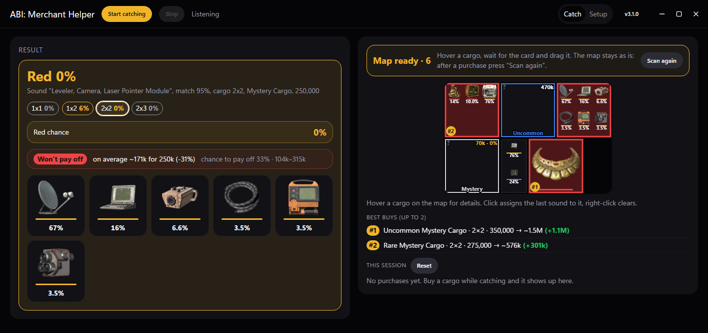
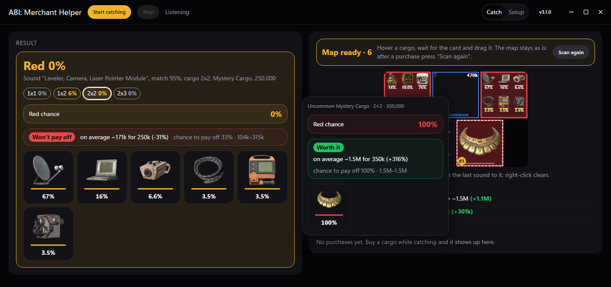
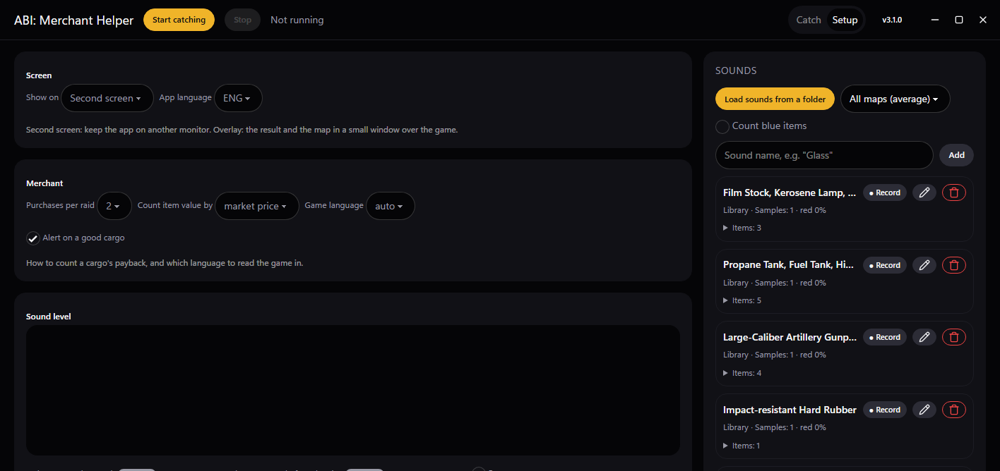
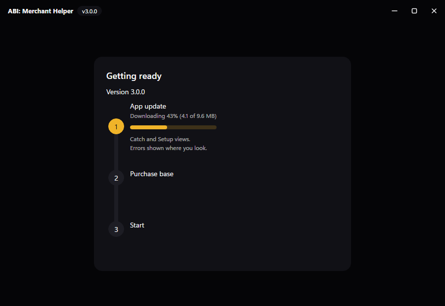

<a href="README.md">English</a> · <a href="README.uk.md">Українська</a> · <b>Русский</b>

# ABI: Merchant Helper

**ABI: Merchant Helper** — программа для Windows для *Arena Breakout: Infinite*, написанная на Rust. Она помогает понять, что лежит в таинственном грузе Полевого торговца, ещё до покупки.

Приложение слушает звук игры, когда ты тянешь груз, и следит за окном торговца. По этим данным оно показывает:

- какие предметы могут быть в грузе и шанс каждого;
- шанс, что в грузе красный (легендарный) предмет.

## Возможности

- **Две вкладки.** **Ловля** показывает только то, что нужно у торговца: результат, карту, лучшие покупки и сессию. **Настройки** содержат остальное: экран и язык, опции торговца, уровень звука, журнал, твои звуки и справку.
- **Распознавание звука.** Когда тянешь груз, игра проигрывает звук подъёма, который зависит от предмета внутри. ABI: Merchant Helper сравнивает этот звук с библиотекой эталонных звуков игры и сужает список возможных предметов.
- **Шанс красного.** Вероятность складывается из четырёх данных: звук, размер груза, его метка (Common / Uncommon / Rare Mystery Cargo или категория вроде *Tools*) и цена. У каждого пула торговца есть метка его груза, поэтому шансы берутся именно из пулов этой метки и цены. Красные чаще всего падают из Mystery Cargo, но и из некоторых более редких категорий (Rare Collectibles, Rare Medical Supplies, Uncommon Military Items…).
- **Автоматическая схема торговца.**
  - Открой торговца и пролистай список. Приложение само находит сетку, читает метки грузов и рисует свою схему.
  - Готовая схема больше не меняется: наведение, перетаскивание и подсказки с ценой её не сбивают.
  - После покупки нажми **Искать заново**, чтобы перестроить её.
- **Цена из подсказки.** Наведи на груз, и приложение прочитает цену из игровой подсказки. Шанс красного виден ещё до того, как ты потянешь груз.
- **Память покупок.** После покупки игра пишет над сеткой «*ник* spent 200,000 Koen on a mystery cargo and obtained [предмет]». Приложение читает эту строку и засчитывает покупку тебе, только если твой баланс Koen под сеткой («Owned») уменьшился ровно на эту сумму. Строки о покупках других игроков игнорируются, ники нигде не сохраняются. Затем сумма сверяется с ценой груза, звук которого был услышан, и записываются звук, размер, метка, цена и выпавший предмет.
- **Общая база покупок.** Каждая записанная покупка попадает в `library/purchases.json`, который идёт вместе с приложением. Страница ещё и при каждом открытии загружает свежую базу с GitHub, так что новые данные приходят без нового релиза. Шансы начинаются с данных торговца (они весят как 20 покупок), а база их уточняет. Чем больше покупок со звуком, тем точнее прогноз, особенно для звуков, общих для нескольких предметов.
- **Синхронизация базы при запуске.** Каждый запуск сначала проверяет обновление, а затем синхронизирует базу (экран запуска показывает каждый шаг):
  - копия с GitHub сливается с локальной;
  - новые покупки уходят на сервер общей базы — Cloudflare Worker (`worker/worker.js`). Ники не сохраняются;
  - Worker отбрасывает всё некорректное: неизвестные предметы или звуки, цены, не совпадающие ни с одним пулом торговца, невозможные даты, слишком большие пакеты. Он также ограничивает число запросов с одного IP, а остальное дописывает в `library/purchases.json` на GitHub. Токен GitHub хранится только в секретах Worker.
- **Окупаемость и лучшие покупки.** Для каждого груза с известной ценой видно, окупается ли он: ожидаемая стоимость того, что выпадет, против цены, шанс получить больше, чем заплатил, и вероятный диапазон. Стоимость можно считать по рыночной цене или по сдаче торговцу. Самые выгодные грузы отмечены на схеме #1, #2…, а под схемой их перечислено столько, сколько можно купить за рейд (от 2 до 4).
- **Сигнал на выгодный груз.** Когда груз под курсором окупается или имеет шанс красного от 25%, звучит короткий сигнал, а журнал его называет. Отключается в **Настройках → Торговец**.
- **Итог сессии.** Под схемой: сколько грузов куплено за сессию, за сколько, сколько красных и сколько стоят предметы. Там же последняя записанная покупка, так что сразу видно, что запись сработала.
- **Отслеживание курсора.** Помощник знает, где мышь, поэтому груз под ней обведён на схеме, а его шансы видны ещё до появления игровой подсказки.
- **Меньше ложных звуков.** Звук засчитывается, только если резко начинается, поэтому ветер и музыка его больше не запускают. Если у лучшего звука нет предмета размера этого груза, берётся близкий второй, который подходит.
- **Автопереподключение.** Если звук или картинка оборвутся, страница сама снова подключится к помощнику.
- **Карточки предметов.** Панель результата, клетки схемы и всплывающая подсказка показывают иконки предметов с шансом каждого. Красные идут первыми.
- **Проблемы на виду.** Если что-то не так (нет окна игры, чёрный экран, не грузится библиотека или не читается текст), в углу окна появляется короткое сообщение, а подробности остаются в журнале.
- **Карта с клавиатуры.** Кликни по карте или перейди на неё Tab: стрелки выбирают груз и показывают его шансы, Enter даёт ему последний звук, Delete стирает.
- **Захват только игры.** Демонстрация экрана не нужна. Программа захватывает:
  - звук только процесса игры (WASAPI process loopback);
  - только окно игры.
- **Один монитор или два.** В **Настройках → Экран** выбери **Второй экран**, чтобы держать программу на другом мониторе, или **Оверлей (1 монитор)**, чтобы карточка результата и схема были в маленьком окне поверх игры. Поставь оверлей на левую половину экрана: захватывается только правая, с торговцем.
- Интерфейс **UA / ENG / RU**.
- **Игра на английском или русском.** Язык игры определяется сам (или выбирается в **Настройках → Торговец**), поэтому надписи грузов, строка покупки и баланс читаются на любом из них.

## Требования

- Windows 10 (сборка 20348 или новее) или Windows 11. В более старых сборках нет захвата звука отдельного процесса, на котором работает помощник.
- [WebView2](https://developer.microsoft.com/microsoft-edge/webview2/) (есть в Windows 11 и в обновлённой Windows 10).
- Игра в режиме **Окно без рамки** (Borderless). В эксклюзивном полноэкранном режиме окно игры не захватывается.

Без браузера и без PowerShell: одна программа со своим окном.

## Быстрый старт

1. Скачай **`ABI.Merchant.Helper_…_Windows-x64-setup.exe`** из [последнего релиза](https://github.com/neverh8me/abi-merchant-helper/releases/latest) и запусти. Программа ставится для текущего пользователя, права администратора не нужны. Windows может предупредить о неизвестном издателе: у установщика нет подписи кода.
2. Запусти **ABI: Merchant Helper** из меню «Пуск» или с ярлыка на рабочем столе. Экран запуска проверит обновление, синхронизирует базу покупок и откроет программу (по умолчанию на английском; выбор языка запоминается).
3. Запусти игру. Затем нажми вверху программы **Начать ловлю**.
4. Открой Полевого торговца, держа курсор вне сетки. Медленно пролистай список до конца и дождись, пока схема зафиксируется.
5. Проверь груз одним из двух способов:
   - наведи на груз, чтобы увидеть шанс красного по цене;
   - потяни груз, чтобы услышать звук и получить разбивку по предметам.
6. Купи груз. Покупка запишется сама, а затем нажми **Искать заново**, чтобы перестроить схему.

Чтобы остановить программу, закрой окно.

## Обновление

Каждый запуск проверяет, есть ли на GitHub более новый релиз. Если есть, экран запуска загружает его со шкалой прогресса, проверяет подпись, устанавливает и перезапускает программу. Твои звуки, профили и покупки сохраняются.

Если новый релиз выйдет, пока программа работает, вверху появится баннер. Нажми его или номер версии в шапке окна, чтобы открыть экран обновления.

Без интернета проверка пропускается.

### Переход с 2.x (start.bat)

Руками ничего делать не нужно. Запусти `start.bat` как обычно и ответь `Y` на вопрос об обновлении. Старый обновлятор скачает маленький скрипт-мост: он сохранит твои звуки, профили и покупки из браузера (на миг откроется вкладка), установит программу и запустит её с твоими данными. Старые ярлыки дальше запускают программу.

## Как это работает

| Часть | Файл | Что делает |
|---|---|---|
| База покупок | `library/purchases.json` | Общие записи покупок. Загружаются из папки приложения и с GitHub и сливаются с твоими покупками. |
| Синхронизация базы | `src-tauri/src/sync.rs`, `worker/` | При запуске сливает локальную базу с GitHub и отправляет новые покупки на Worker, который их проверяет и коммитит в общую базу. |
| Обновление | `src-tauri/src/lib.rs`, `src-tauri/shell/` | Экран запуска: находит более новый релиз на GitHub, загружает его с прогрессом, проверяет подпись и устанавливает. |
| Программа | `src-tauri/src/` | Rust (Tauri). `capture.rs` берёт звук игры (WASAPI process loopback) и кадры окна игры (~30 кадр/с); `server.rs` отдаёт страницу внутри программы и транслирует ей оба потока. |
| Мост с 2.x | `bridge/` | Единственный оставшийся скрипт PowerShell: переводит установленную 2.x на программу. |
| Распознавание звука | `audio.js` | Нормированная взаимная корреляция по полосам частот (5 полос, шаблон 0,2 с) с эталонными звуками игры и определением начала звука в каждой полосе. |
| Библиотека звуков | `library.js`, `library/` | Эталонные звуки, группы «звук → предметы», пулы торговца с весами и иконки предметов. |
| Зрение сетки | `vision.js` | Находит линии сетки торговца и размер клетки. Отделяет грузы (серые) от пустых клеток (чёрные) и следит за прокруткой по полосе прокрутки. |
| OCR | `ocr.js`, `lib/tesseract/` | Tesseract.js в окне программы. Читает метки грузов и цену из подсказки. |
| Интерфейс | `index.html`, `i18n.js` | Сводит всё это в вероятности, рисует схему и отвечает за переводы. |

### Шанс красного

Для каждого груза цена сопоставляется с ближайшим пулом торговца, а метка груза определяет тип пула. Звук затем ограничивает возможные предметы. Веса предметов берутся из данных пулов торговца — для выбранной карты или в среднем по всем картам. Шанс красного — это взвешенная доля красных предметов среди оставшихся кандидатов.

## О точности

- Результаты — это вероятности, а не гарантии. Многие красные и золотые предметы имеют одинаковый звук подъёма. Поэтому приложение показывает процент, а не один ответ.
- Текст читается на английском или русском, на языке игры. Цены читаются при любом языке игры. Часть русских названий предметов — наш перевод и может отличаться от игрового, тогда такой предмет может записаться без названия.
- Для более точных весов выбери текущую карту на панели **Звуки**.

## Авторы

- Создано **neverh8me** и **Claude Code**.
- [Tesseract.js](https://github.com/naptha/tesseract.js) (Apache-2.0) для OCR.
- Данные пулов торговца и иконки предметов — с [abibuilder.com](https://abibuilder.com).

## Отказ от ответственности

Это фанатский инструмент, не связанный с MoreFun Studios или Tencent. Он не читает и не изменяет память или файлы игры. Он только слушает звуковой выход игры и захватывает её окно, как программа для записи экрана. Используй на свой риск.

## Лицензия

ABI: Merchant Helper — свободное программное обеспечение под [GNU General Public License v3.0](LICENSE). Его можно использовать, изучать, изменять и распространять. Если распространяешь изменённую версию, она должна оставаться под той же лицензией и идти вместе с исходным кодом.

Сторонние части в комплекте сохраняют свои лицензии: [Tesseract.js](https://github.com/naptha/tesseract.js) в `lib/tesseract` — Apache-2.0. Звуки игры, данные предметов и иконки в `library/` принадлежат своим владельцам и этой лицензией не охвачены.
